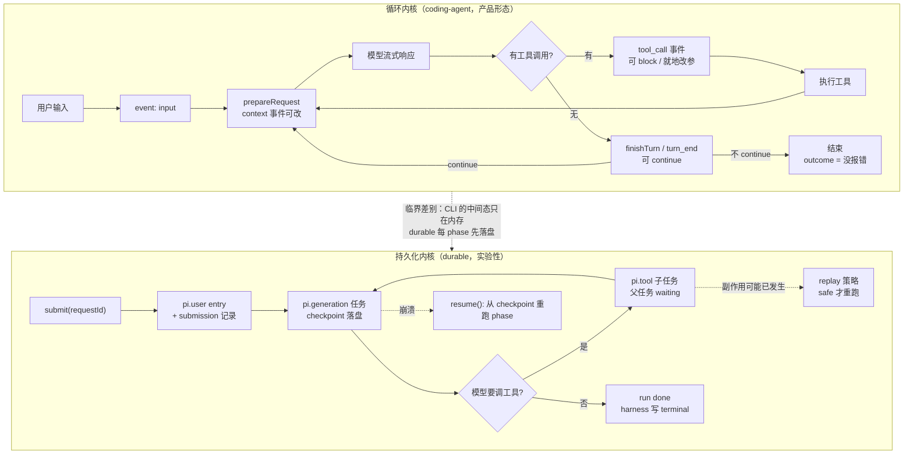

# 手册第 4 章 × pi-main 对照精读

> 对照对象
> - 手册：《AI Agent 工程实践手册》第 4 章「任务：编排、长程推进与协作流转」（`02-docs/ai-agent-handbook-main/02-build/第 4 章 任务：编排、长程推进与协作流转.md`，439 行）
> - 实现：`01-projects/pi-main`（@earendil-works/pi monorepo），基于当前 checkout 源码阅读，未运行测试
> - 日期：2026-11-01
> - 原始调研笔记（含更细的 file:line 与代码片段）：`.research/pi-ch4-notes/{42-43-plan-subagent,44-async-durable,45-46-middleware-verify}.md`
> - 前置：`.research/pi实现对照-手册4.1.md` 单独覆盖过 4.1，本文把它纳入全章视角重述

## 0. 三句话结论

1. **pi 把第 4 章拆成了两个内核，而手册假设只有一个。** `packages/agent` + `packages/coding-agent` 是"循环内核"（转录驱动、进程内、无任务对象）；`packages/durable` 是"持久化内核"（任务树、checkpoint、等待睡眠、崩溃恢复）。章里 4.1/4.4 想要的"权威状态 + 长程续行"只在后者成立，而**后者不驱动那个卖出去的 CLI**（`coding-agent` 的依赖里没有 `pi-durable`，全仓只有 `packages/env` 依赖它）。

2. **手册把"完成"当内核职责，pi 把"完成"和"验证"都交出去了。** 但在 durable 里，pi 有一件手册强调的事做对了：**终态是 harness 代码写的，模型不能自称完成**——`generation` 任务以 `{status:"completed", result:{entryId}}` 收尾（`generation.ts:1140`），失败还有 10 个 harness 判定的具名理由（`live.ts:108-118`）。缺的不是"申请 vs 提交"的分离，缺的是**证据**：`answer` 只是一个 assistant entry 的 id，没有 artifact 清单、没有缺口结构、没有 verifier 抽象。

3. **pi 在"任务如何不死"上比手册更硬，在"任务如何算对"上比手册更软。** 硬：sleeping 无 invocation、结构化并发（abort 自底向上、completing 持有）、effect sandwich、`requestId` 幂等、restart limit、任务图可观测。软：没有 WAITING_INPUT/APPROVAL/PAUSED/VERIFYING、没有证据门禁、预算只有 `maxTurns`、审批只有工具级 block、无进展检测完全没有。

---

## 1. 先看骨架：两套内核 + 三层 middleware

这是理解全章的前提。手册把"Harness 执行内核"和"Middleware"都当单一概念，pi 各有多个实现。

### 1.1 两套执行内核

| 层 | 包 | 职责 | 谁在用 |
| --- | --- | --- | --- |
| LLM 访问 | `packages/ai` | 多 provider 统一 API、模型目录、流式、重试分类、faux provider | 全部 |
| 循环内核 | `packages/agent` | `runLoop`：装配请求 → 流式响应 → 执行工具 → 决定是否继续 | `coding-agent` |
| 产品壳 | `packages/coding-agent` | CLI/TUI/RPC/SDK、session（JSONL 树）、工具集、扩展系统、压缩 | 终端用户 |
| 持久化内核 | `packages/durable` | Harness/Conversation/Task/Document/Submission：提交式状态、调度、等待睡眠、恢复 | **仅 `packages/env`**（实验性） |
| 状态底座 | `packages/chord` | 文档状态、复制、RPC over JSON link | durable、插件宿主 |

核对过的事实：`packages/coding-agent/package.json` 的 dependencies 里没有 `@earendil-works/pi-durable`，`packages/coding-agent/src` 下 grep `pi-durable` 零命中；`pi-durable` README 首行自述 **Experimental**。

**这条事实改变整章对照的读法**：凡是"pi 有/没有"，都要先问是哪个内核。手册 4.4 说"把成熟 Harness 嵌入企业服务"，pi 确实做了一套（durable），但它是实验室里的第二内核。

### 1.2 三层 middleware，同名不同义

手册 4.5 假设存在统一的 middleware 契约。pi 有三套，**同一个概念在三层的语义不同**，混着看会得出相反结论：

| 概念 | `packages/agent` | `packages/coding-agent` | `packages/durable` |
| --- | --- | --- | --- |
| 工具调用前 | `beforeToolCall`：**只能 block**（`agent/types.ts:66-74`） | `tool_call` 事件：block + **就地改参**（`extensions/types.ts:1474-1483`） | `beforeTool`：block + **结构化换参**（`harness/types.ts:1026-1031`） |
| 工具调用后 | `afterToolCall`：字段级替换 | `tool_result`：字段级替换 | `afterTool`：整体替换 `ToolExecutionResult` |
| 请求前 | `prepareRequest`：可换 context/model/thinking（`agent-loop.ts:228-248`） | `context` / `context_with_system` / `before_provider_request` | `beforeRequest`（只对本次请求生效） |
| 回合结束 | `finishTurn`：`continue \| end`（`agent/types.ts:146-147`） | `turn_end`：结构化 draft + continue | `onYield`：`{ continue: UserInput }` |
| 形态 | 函数字段（直接赋值） | 注册制事件（40+ 个） | 扩展上的 hook 声明 |

`docs/how-pi-works.md`（49 行）是 pi 自己的架构自述，值得先读；它描述的完全是循环内核 + session 那条线，通篇没有 task / checkpoint / resume。

---

## 2. 第 4 章到底在问什么（把六节串成一条线）

手册的论证链是一条：**一次模型调用是一个离散判断，一个企业任务是一个有始有终的过程，中间缺三样东西——状态、边界、证据。**

- 缺状态 → 拿消息历史冒充任务状态，模型要从几百条消息里猜进度（4.1.2）
- 缺边界 → 不知道何时该停、何时该等、何时该问人（4.1 的状态机、4.4 的等待）
- 缺证据 → 把"模型说做完了"当成"做完了"（4.6）

中间三节是"怎么把任务组织得能被状态描述"：Planning/Todo 外部化结构（4.2）、Subagent 切分并行与责任（4.3）、异步与续行让过程跨越连接和上下文窗口（4.4）。4.5 讲工程结构与测试，4.6 收在完成验证。

带上这条线看 pi：**pi 在"边界"和"结构"上正面作答，在"状态"和"证据"上把责任推给上层。**

---

## 3. 六节对照总表

| 手册机制 | pi 的落点 | 判定 |
| --- | --- | --- |
| 4.1 Loop 五阶段 | `runLoop` 双层循环（`agent-loop.ts:172-330`）；无 Verify 阶段 | 四阶段覆盖，Verify 缺失 |
| 4.1 权威任务状态对象 | agent 层状态 = 转录（`agent/types.ts:382-421`）；durable 层有 checkpoint，但语义是执行进度不是任务意图 | 部分覆盖，且落在第二内核 |
| 4.1 十态状态机 | durable 六态 `pending/running/waiting/sleeping/completing/terminal`（`durable/types.ts:658-702`） | 结构更严，表达力更窄 |
| 4.1 预算（步数/时长/Token/费用/并发/风险动作） | 仅 durable `maxTurns`（`durable/README.md:404`）；CLI 侧 grep `maxSteps\|maxTurns\|stepLimit\|costLimit` 零命中 | 缺失 |
| 4.2 计划外部化 | CLI：从回复里正则抽 `Plan:` 段落 + `appendEntry("plan-mode", …)` 存快照；durable：计划是版本化 document（`fork:"asOf"`） | 覆盖（示例层） |
| 4.2 Plan Mode 的"获批前不可写" | 工具白名单 + bash 只读白名单 + **HITL 确认**（Execute/Stay/Refine）；**没有**权限模式抽象 | 四件套有其三，但白名单可绕 |
| 4.2 三种控制强度（Todo/Plan/Planner–Executor） | 三者都有示例：`todo.ts`、`plan-mode/`、`subagent` 的 chain + `planner.md`/`worker.md` | 覆盖（示例层） |
| 4.2 阶段门禁 | 无阶段/产物/门禁概念；durable 的 `phase` 是恢复单位不是验收单位 | 缺失 |
| 4.3 Subagent 三价值 | CLI：独立 `pi` 子进程（`--no-session`）；durable：子 conversation 被父任务拥有 | 两种形态都实现了 |
| 4.3 委派契约七项 | 覆盖五项；**预算、验收条件缺失** | 部分覆盖 |
| 4.3 Delegation vs Handoff | Delegation 覆盖；Handoff 是同名不同物（上下文提炼 + 新会话 + `parentSession` 血缘） | 部分 |
| 4.3 合并结果 / FAIL_FAST 等四策略 | CLI 硬编码两种（chain=FAIL_FAST，parallel=BEST_EFFORT）；durable `failFast\|allSettled` + `outcomes()`，且 failFast 只能等自己拥有的任务 | durable 覆盖，CLI 只有两种 |
| 4.4 任务身份与连接解耦 | durable：`requestId` 幂等 + `harness.submission(id)` 重取 + `resume()` | 覆盖 |
| 4.4 等待时释放计算资源 | `waiting`/`sleeping` 任务无 invocation（`durable/types.ts:673-690`）；但 Node 进程仍被最早 sleep 的定时器保活（`scheduler.ts:1786-1801`），真正释放算力要靠宿主 evict + `onWake` | 部分（执行释放了，进程没释放） |
| 4.4 事件序号/游标 | 无任务级序号；只有 commit `Seq`、entry `Cursor`、watch 的 `from` 窗口，RPC 侧 `get_entries { since }` | 部分 |
| 4.4 Context Reset + Continuation | `reset()` 写 `pi.reset` entry（`head:"self"`）；handoff 文本；压缩摘要 prompt 有固定小节 | 部分（Continuation 是自然语言，非结构） |
| 4.4 多实例共享 Session | **一个写者 + N 个只读 viewer**；`README.md:881` 明写 "no cross-process locking" | 部分（≠ 任意实例可 resume） |
| 4.5 稳定内核 + 可插拔 | 三层 middleware，40+ 事件，`agent` 层 6 个 hook | 覆盖，但语义不统一 |
| 4.5 结构化 Decision/Patch 由内核统一提交 | `turn_end`/`agent_before_settle` 返回 `{entries?, continue?}`，由 `_commitBoundaryDrafts` 统一提交 | 覆盖（仅两个时机） |
| 4.5.2 四类确定性测试 | 四类都有真实资产；**恢复测试的强度集中在 durable**（真 close/reopen + SQLite），coding-agent 侧是会话快照重放 | 覆盖，强度不均 |
| 4.6 按失败类型选策略 | 瞬时错误有界退避（正则分类，`ai/src/utils/retry.ts`）；参数/环境/权限/业务条件**无恢复分支** | 部分 |
| 4.6 副作用重试前先确认 | 执行前先提交 intent；恢复时只有 `replay==="safe"` 才重跑，否则给模型 "interrupted and may have partially run"（`harness/tool.ts:194-226`） | 覆盖，但"查状态"要靠工具作者 |
| 4.6 无进展检测 | 无；连最大步数也没有（只有 durable `maxTurns`） | 缺失 |
| 4.6 完成由证据决定 | 终态由 harness 写（不是模型自称），但**无证据模型**：`answer` 是 entry id | 分离成立，证据缺失 |
| 4.6 验证强度五层 | 只有结构验证与环境验证，且都不是任务产物验证；独立模型验证只有 reviewer 示例，且**靠模型自述"没有更多问题了"** | 缺失 |

### 3.1 一张图：同一次任务提交，在两个内核里怎么走



看这两条路径的差别，比看状态名列表有用：CLI 那条每次"准备/调用/执行"都在内存里，只有消息和工具结果写进 session；durable 那条**每个 phase 结束前必须提交**，否则任务被判 `faulted`（"no durable progress"）。手册 4.1.2 想要的"可机读权威状态"，本质上是这条"每步先落盘"的纪律，而不是一个 YAML 对象。

---

## 4. 逐节展开

### 4.1 Agent Loop 与任务状态机

**pi 的实现**（细节见前置文档，这里只补全章视角）：

- 双层循环：内层跑工具轮，外层在 agent 本要停止时检查 follow-up 队列（`agent-loop.ts:172-330`）。
- 终止只有三种：`stopReason` 为 error/aborted、`finishTurn` 返回 end、无工具调用且无排队消息。
- **CLI 的"完成"其实是"这一轮没报错"**：`_lastActivityOutcome = stopReason === "aborted" ? "aborted" : stopReason === "error" ? "error" : "completed"`（`agent-session.ts:866-867`）。这句话值得盯住看——它不是"目标达成"。
- agent 层状态（`agent/types.ts:382-421`）全是转录与运行时旋钮：systemPrompt/model/thinkingLevel/tools/messages/isStreaming/…，没有 goal/stage/todos/evidence。

**判定**：四阶段覆盖且更细（工具装载差异显式声明、`stopReason=length` 时拒绝执行截断工具调用）；Verify 与权威任务对象缺失；预算缺失。

**点评**：手册的"权威状态"混装了两类信息——**执行状态**（跑到哪个 phase）和**业务状态**（目标达成到哪）。pi 把前者做到极致（durable checkpoint），后者完全留白。看清这个分离，4.1.2 的 YAML 就不再是一个对象，而是两个。

> 业务状态在 durable 里有正式落点：`defineDoc` 声明的 document，可以 `scope:"conversation"`、`history:"rewindable"`、`fork:"asOf"`，与转录一起原子提交（`durable/README.md:98`、`test/examples/26-plan-mode.ts:33-44`）。手册要求的 facts/artifacts/completion_evidence，在 pi 里就是"你自己定义几个 document"。

### 4.2 Planning、Todo 与阶段目标

**三种控制强度，pi 三种都有，但都是示例扩展**（`README.md:19` 明说不内置）：

| 强度 | 位置 | 关键实现 |
| --- | --- | --- |
| 轻量 Todo | `examples/extensions/todo.ts` | `todo` 工具；状态存 toolResult 的 `details`，用 `reconstructState()` 扫分支重建（`todo.ts:114-123`） |
| Plan Mode | `examples/extensions/plan-mode/` | 工具白名单 + bash 只读白名单 + HITL 确认 + 计划抽段 |
| Planner–Executor | `examples/extensions/subagent/` | chain 模式 + `planner.md`（只读）→ `worker.md` + `prompts/implement.md` |

*Todo 的存储取向与手册相反*，而且这个相反很有道理：

> State is stored in tool result details (not external files), which allows proper branching - when you branch, the todo state is automatically correct for that point in history.（`todo.ts:8-10`）

手册说"Todo 保存在 Agent 状态中，因此能跨调用恢复"（暗示状态独立于消息）。pi 说"Todo 就存在转录里"——因为会话是树，切到任意历史节点后 Todo 自动正确；若存在外部状态，切分支就会不一致。

*Plan Mode 比想象中完整*，四件套有三件：

| 手册要求的 | pi 的对应 | 证据 |
| --- | --- | --- |
| 工具白名单 | `setActiveTools` 摘掉 `edit`/`write`（`PLAN_MODE_DISABLED_TOOLS`，`index.ts:24`） | 真在模型视野里生效 |
| bash 只读 | `SAFE_PATTERNS`/`DESTRUCTIVE_PATTERNS` 正则双向判定，非安全即 `{block:true}`（`utils.ts:7-101`） | 启发式，非能力边界 |
| 持久状态 | `pi.appendEntry("plan-mode", {enabled,todos,executing,toolsBeforePlanMode})`，`session_start` 恢复（`index.ts:116-123, 344-361`） | 跨 resume 成立 |
| **HITL 审批** | `agent_end` 后 `ctx.ui.select`「Execute the plan / Stay in plan mode / Refine the plan」，选 Execute 才 `restoreNormalModeTools()`（`index.ts:305-319`） | **有**（容易被漏看） |
| 权限模式 | 无此抽象；`docs/security.md:3` 明说"不对每次 tool call 求批准" | 缺 |

**但"获批前不可写"在实际中可绕**，这是最值得注意的发现：

- `PLAN_MODE_DISABLED_TOOLS` 只含 `edit`、`write` 两个**名字**（`index.ts:24`），其余 active 工具全部保留（`index.ts:90-95`）。任何自定义写工具（包括 `subagent`）在 plan mode 下依然可调。
- `subagent` 子进程用默认工具集启动（`subagent/index.ts:298`），plan mode 的白名单**不传播**——"委派一次就绕过只读门禁"。

**判定**：计划外部化覆盖（durable 版更强：版本化 document + fork 语义）；三种强度齐备但都是在 `examples/` 里，互不复用；HITL 有但粗（一次确认，无"批准了什么范围"的记录）；阶段门禁缺失；计划修订不记录触发事实（Refine 只把补充作为 follow-up 投递，`index.ts:334-339`）。

**点评**：手册 4.2.3 那句"只有权限模式、工具白名单、持久状态与 HITL 共同生效，系统才真正具备计划获批前不可写的约束"——pi 缺的恰好是**权限模式**这一层抽象，于是白名单只能按工具名挡，挡不住"工具内部的写"和"子进程"。这验证了手册的判断：**没有权限模式，白名单就只是约定**。

### 4.3 Subagent 与任务委派

pi 默认不带 subagent，同仓两套实现（第七节有对照表）。契约七项在 CLI 版的落点：

| 契约项 | pi 的载体 | 是否强制 |
| --- | --- | --- |
| 目标与边界 | 工具参数 `task` + `cwd`；无结构化范围声明（`subagent/index.ts:440-444`） | 靠 prompt |
| 已知上下文 | 子进程 `--no-session` 全新会话，只给 `--append-system-prompt <tmpfile>` + `Task: <task>`（`index.ts:298-339`） | **结构强制，比手册更彻底** |
| 能力与权限 | frontmatter `tools:`/`model:`；权限继承 OS 账户，无降权（`agents.ts:14-18`） | 工具声明强制，权限不强制 |
| 预算 | **无**。只有 `MAX_PARALLEL_TASKS=8`/`MAX_CONCURRENCY=4`/`PER_TASK_OUTPUT_CAP=50KB`（`index.ts:34-37`），无超时 | 缺失 |
| 输出与证据 | 最后一条 assistant 文本 + `details`（完整 messages/usage/exitCode）；无 schema（`index.ts:168-178`） | 弱 |
| 失败语义 | `exitCode!==0 \|\| stopReason error/aborted`；chain 遇错即停，parallel 跑完汇总（`index.ts:180-182, 585-593`） | FAIL_FAST/BEST_EFFORT 硬编码，无 retry/escalate |
| 验收条件 | 无 | 缺失 |

两个必须说的证据：

1. **reviewer 的 prompt 自己承认能力隔离不彻底**："Assume tool permissions are not perfectly enforceable; keep all bash usage strictly read-only."（`agents/reviewer.md:10`）——`bash` 的 `tools:` 白名单只决定它能不能被调，不限制它内部做什么。
2. **取消靠杀进程**：`SIGTERM` 5 秒后 `SIGKILL`（`index.ts:408-414`），没有"先让子代理收尾"的语义。

*Delegation vs Handoff*：Delegation 覆盖（结果作为 toolResult 回到父会话）。Handoff **同名不同物**：`handoff.ts` 做的是"把上下文提炼成一条 prompt，开一个新 session"，用 `parentSession` 记录血缘，草稿进编辑器由用户确认（`handoff.ts:177-183`）。它有血缘，但**没有责任变更记录、没有状态转移**。真正接近手册 Handoff 语义的是 durable 的两条边：

```ts
readonly parent?: { conversationId: ConversationId; at: EntryId };  // fork 来源 + 到哪一条 entry
readonly owner?: { conversationId: ConversationId; taskId: TaskId }; // 创建者任务：归属、子树取消、子树 idle 等待
```
（`durable/types.ts:428-438`）

*并发写同一工作区*：CLI 的 parallel 模式让多个子进程共用一个 `cwd`，**无 worktree 隔离、无分支、无补丁合并**。唯一的串行化是进程内按键的变更队列，注释自己写明"Not a lock against `bash` or other processes"（`packages/*/src/tools/file-mutation-queue.ts:28-32`）。手册 4.3.3 那句"不能依赖'大家小心不要冲突'"，pi 恰好是依赖这个。

**判定**：三价值覆盖；契约五项覆盖（预算、验收缺）；Delegation 强、Handoff 弱；并发写缺失。

**点评**：手册把子代理当**运行时分派**，pi 把它当**产品可选项**。差别在责任归属：pi 的 Harness 只保证"子代理不污染父上下文、父崩了不会留下活着的子代理"，不保证"子代理花多少、做对没"。后者需要业务语义，pi 不做。

### 4.4 异步任务与长程续行

这是 pi 与手册最接近的一节，因为 durable 就是照这个思路做的。

- **等待即落盘**：`waiting`/`sleeping` 的任务 "Parked without an invocation"（`durable/types.ts:673-690`），调度器把它们的候选丢掉（`scheduler.ts:2012-2019`）。**但**同一进程里最早 sleep 的定时器 "keeps the process alive"（`scheduler.ts:1786-1801`）——释放的是执行，不是算力；真释放要靠宿主 evict + `onWake`（`README.md:166`）。
- **等待之后不能在同一 phase 继续**：phase 崩溃后从头重跑，所以"等待后的工作必须在下一个 phase，需要的东西放进 checkpoint"（`README.md:162`）。这条约束比手册更狠，也更诚实。
- **恢复与重启计数**：open 时把 `running` 改回 `pending` 且 `restarts+1`（`scheduler.ts:452-457`），到 `restartLimit`（默认 5）结束任务（`README.md:216`）。这是手册"无进展检测"的**一个特例**。
- **幂等**：输入级 `requestId` 去重；工具级 `replay: "safe"` 声明 + 嵌套调用 key（"a replay-safe caller that reruns after a crash and calls in the same order gets the nested calls it already made back"）。
- **取消是"标记 + 派生"不是"递归调用"**：reconcile 每轮从意图节点向下重算标记（`scheduler.ts:1103-1110`），因为崩溃会丢掉在途传播（`spec.md:2497-2501`）。abort 自底向上，且 abort handler 不能再创建 owned 子任务，只能内联补偿或建 background 任务（`spec.md:6400-6405`）。
- **副作用不消失**：非 replay-safe 的工具恢复后给模型 "Tool X was interrupted and may have partially run"（`harness/tool.ts:200-226`）；无定义可跑的取消是 `orphaned` 而非 `aborted`，spec 写明理由"外部副作用可能没清理"（`spec.md:2592-2597`）。
- **Context Reset**：`reset()` 是一次 write submission，写 `pi.reset` entry 且 `head:"self"`，handoff 文本作为 user message（`spec.md:1071-1074`）。压缩摘要 prompt 有固定小节 Goal / Constraints / Progress(Done·In Progress·Blocked) / Key Decisions / Next Steps / Critical Context（`harness/compaction.ts:76-107`）——这其实就是 pi 版的 Continuation，**但是自然语言，无结构校验**。
- **多实例**：存储可拔（SQLite/JSONL/Durable Object/IndexedDB/Memory），但 `README.md:881` 写死："One process owns a storage at a time; there is no cross-process locking." `readOnly` 打开的是 viewer（`spec.md:838-845`）。所以是"一写多读"，不是手册的"任意实例 resume"。两个活实例同时非只读打开同一 storage，后开者会把前者的 `running` 计为 crash。

**判定**：任务身份、等待、恢复、取消、幂等——覆盖且更工程化；"释放算力"部分（需宿主配合）；事件游标部分；Continuation 部分是自然语言；多实例是"读扩散、写单点"。

**点评**：手册 4.4 有一段容易读漏的话——"恢复时重新检查目标、外部条件、工具是否实际执行、权限是否仍有效、工作区是否变化"。pi 对"工具是否实际执行"给了机制，对"权限/工具集是否还在"给了机制（每 phase 重解析 registry，工具没了给 `tool_unavailable`），对"工作区是否变化"反而**明确承认是 footgun**："a tool rerun after recovery builds its environment again, with the conversation's current `cwd`, which may differ from the first attempt's"（`spec.md:6493-6495`）。对"目标还成立吗"给零机制——checkpoint 对 Harness 是不透明的 `S`，它不知道目标是什么。

### 4.5 Middleware 与执行内核测试

**pi 在这节全面达标，且有一处超出，但语义一致性不足。**

*顺序与失败语义*是明确规定的：

> Handlers run in extension load order, then registration order within each extension. Adding or removing a handler does not affect a dispatch already in progress.（`docs/extensions.md:1566`）

*结构化 Patch 由内核统一提交*——手册 4.5.1 的建议，pi 就是这么做的：

> Each handler sees prior proposals in `event.entries` ... Returning `entries` or `continue` replaces only that field; omitted fields preserve the current proposal. Allowed draft entry types are `custom`, `custom_message`, `context_edit`, and `compaction`. The complete proposal is validated before it is appended in list order after all handlers finish; a handler error is reported and later handlers still run. Validation prevents partially applied semantic errors, but persistence is not transactional.（`docs/extensions.md:734`）

实现上：`emitBoundary` 逐个 handler 累积提案，**每个 handler 之后重建 context 让下一个看到上一步结果**（`runner.ts:1046-1080`），最后由内核 `_commitBoundaryDrafts` 统一 append（`agent-session.ts:1040-1044`）。三个设计决定值得学：提案式而非直写式；只允许四类 draft entry（扩展不能凭空插 assistant 消息）；失败隔离（一个 handler 抛错只上报，后面照跑；非法提案整批作废）。

*但有三处不一致，需要点名*：

1. **没有声明式读写范围**。有的时机是"就地改可变对象"（`tool_call.input`、`before_provider_headers.headers`、`before_agent_start.systemPromptOptions`），有的是"返回值链"。谁改了共享对象，类型上约束不住。
2. **冲突规则分散且不一致**：`tool_call` 第一个 block 胜；`tool_result`/`message_end` 字段级 last-wins；`project_trust` 第一个 yes/no 胜；同名 tool "keeps first"。有规则，但只有碎片（文档+测试），没有一览表。
3. **相邻两条路径失败语义相反**：`tool_call` handler 抛错 = **阻断工具**（fail-safe）；`tool_result` handler 抛错 = **吞掉继续**。`emitToolCall` 连 try/catch 都没有（`runner.ts:1257-1262`）。

还有一处直接违反手册 4.5.1"不应绕过统一 Action Plane"：`event.input` 就地可改，**改完不再校验**（`extensions/types.ts:1270-1275`）。

*4.5.2 四类测试的真实资产*：

| 手册测试类型 | pi 的资产 | 判定 |
| --- | --- | --- |
| 状态迁移 | `agent/test/agent-loop.test.ts`（finishTurn 时机、terminate 整批、block+terminate、并行部分 terminate）；`coding-agent/test/suite/agent-session-boundaries.test.ts`（续跑、settle 期间 abort、非法 continuation） | 有，断言事件序列而非白盒状态机 |
| 扩展顺序 | `coding-agent/test/extensions-runner.test.ts`（load/registration order、冲突、短路、抛错隔离、boundary 链式提案、非法提案被后来者修复、dispatch 中注册延后生效…） | **有且很强，四类里最完整** |
| 恢复 | `durable/test/harness-tools-recovery.test.ts`（真 SQLite + close/reopen：unsafe 中断、safe 重跑、"stored 与 current 双 safe 才重跑"、重跑用重跑时刻的 cwd…）；`harness-tasks-recovery/generation-recovery/restart-failure/nested-tools-restart` | **有且最强**；coding-agent 侧是会话快照重放，不是真杀进程 |
| 预算与边界 | `durable/test/harness-turn-limit.test.ts`（`turn_limit`、continue 后预算重置、`maxTurns` 校验）；`harness-blocked.test.ts`（restartLimit、同 checkpoint 不算 progress） | 只有 durable 有；**CLI 零预算测试** |
| 模型输出可替身 | `fauxProvider` + `setResponses/appendResponses`（`ai/src/providers/faux.ts:42-80`）；`coding-agent/test/suite/harness.ts:151-158` | 有模拟器；**无录制回放** |

**判定**：结构、顺序、失败隔离、四类测试——覆盖且部分超出。语义一致性（读写范围、冲突规则、失败语义）比手册要求的弱。

**点评**：pi 的扩展是**同进程任意 TS 代码**，`spec.md:6531` 的 non-goals 明写 "no forced termination of non-cooperative extension code inside one process"——扩展死循环，Harness 只能等。手册没讨论，但做企业 Harness 时这是硬约束。

### 4.6 可靠性与完成验证

*按失败类型选策略*：pi 只对**瞬时错误**有策略——`retryAssistantCall` 指数退避 + 上限（`ai/src/utils/retry.ts:209-259`），分类靠**错误字符串正则**（`retry.ts:7-35, 37-125`）。手册的六类里，参数/环境/权限三类被折叠成"工具返回 error result 交给模型自己看"，业务条件与重复探索完全没有分支。降级路径不落审计（能换 model，但不记"为什么换了"）。

*副作用确认*：这是全仓最贴近手册的一段代码。执行前先提交 intent：

```ts
const intent = { phase: "execute", arguments: final, replay: tool.replay ?? "unsafe" } as const;
return { status: "running", checkpoint: intent };
```
（`harness/tool.ts:194-197`）

恢复时只有 `replay === "safe" && tool?.replay === "safe"` 才重跑，否则把调用结束成 "Tool X was interrupted and may have partially run"（`tool.ts:200-226`）。**但**它不"查询状态"——`replay` 是工具作者声明的静态属性，README 自己承认 "a replay-safe tool with external effects still needs its own idempotency"。手册要的是"先问外部系统上次成没成"，pi 给的是"你自己声明能不能重跑"。

*无进展检测*：**完全没有**。grep `no progress|stuck|consecutive|repeated|loop detect` 在 `coding-agent/src`、`agent/src` 只命中 MIME 探测、diff 连续行之类。唯一的"进度"概念在 durable 的 `restartLimit`——那统计的是"崩溃且 checkpoint 未变"，不是"模型在打转"。手册说"无进展检测比最大步数更早发现问题"，pi 是两者皆无（CLI 连最大步数都没有）。

*完成判定*——这里要分三层说清，不能一句"缺失"带过：

| 层 | "完成"是什么 | 证据 | 性质 |
| --- | --- | --- | --- |
| agent loop | 没有工具调用、没有排队消息、没有显式续跑 → `agent_end` | `agent-loop.ts:305-329` | **没有"完成"概念**，只有停止 |
| coding-agent | `outcome = stopReason==="error" ? "error" : "completed"` | `agent-session.ts:866-867` | `"completed"` = 这一轮没报错 |
| durable | generation 任务写 `{status:"completed", result:{entryId}}`；失败有 10 个具名理由（model_error/no_model/aborted/reset/faulted/orphaned/interrupted/restart_limit/nothing_to_answer/turn_limit） | `generation.ts:1140`、`live.ts:108-118` | **终态由 harness 写，模型不能自称** |

所以手册 4.6.2 的"模型只能申请完成，Harness 才能提交完成"在 durable 里**结构上成立**。不成立的是"依据事实"：`answer` 只是一个 entry id（`types.ts:1010-1011`），不是 artifact 集合；没有缺口结构，没有可修复性判定。

*验证强度五层*，pi 只有前两层，且都不是任务产物验证：

| 层级 | pi 有吗 |
| --- | --- |
| 结构验证 | 有，但验的是工具参数/输出 schema，不是任务产物 |
| 环境验证 | 有，但那是工具在读真实文件，harness 不比对"预期 vs 实际" |
| 确定性验证 | 无内建。`32-tests-after-edits.ts` 是示例：改完跑测试，失败提交 follow-up，最多 3 次 |
| 独立模型验证 | 只有 `27-reviewer.ts` 示例：独立 conversation、便宜模型、只读工具、独立 cwd；但它断言完成的方式是 `onYield` 里问"说到 'No further findings.' 没有"——**靠模型自述** |
| 人工验收 | 有，但在**执行前**（tool_call 拦截 + UI confirm），不在完成前 |

最后一行是最值得注意的地方：pi 唯一接近"独立模型验证"的示例，判定完成的依据恰好是手册 4.5.1 表格里列为"不应做的事"的"仅凭模型自述标记完成"。

**判定**：失败分类部分、副作用确认覆盖、"申请/提交"分离在 durable 成立；证据层、无进展检测、验证强度后三层缺失。

**点评**：这是全章分歧最大的一节，也最值得学。手册假设"内核能判断任务是否完成"；pi 的假设是"内核不可能知道你的业务什么叫完成，所以只提供**终态的写者**和**强制迭代的钩子**，判断交给组合"。前者可强制、可审计，后者可组合、不会误判。企业落地时这个选择几乎决定整个 Harness 的形状。

---

## 5. 四个最深的分歧（讲透）

### 5.1 "状态"是执行进度还是任务意图

手册 4.1.2 的 YAML 同时装了两类信息。pi 拆开且只做一半：

| 信息 | 手册 | pi |
| --- | --- | --- |
| 跑到哪一步（可恢复） | 同一个 task 对象 | durable task record + opaque checkpoint |
| 目标达成到哪（业务语义） | 同一个 task 对象 | 你自己的 document（`defineDoc`） |
| 完成证据 | 同一个 task 对象 | 你自己的 document 或 entry |

`pi.live` 的定位写得很直白：**"Run control and presentation"**（`harness/live.ts:158`）——只管运行控制与展示，不是业务状态。拆开的好处是内核不必理解业务；代价是手册 4.1.3 那句"模型看到的是由状态生成的当前任务视图"在 pi 里默认不成立，得你自己拼。

### 5.2 "完成"是内核判定还是组合模式

见 4.6。补一个细节：pi 的边界事件确实能强制"再来一轮"，所以它**不缺机制，缺策略**。差别在于：机制允许你写 verifier；策略意味着 verifier 默认存在且模型绕不过去。

还有个连带问题值得警惕：**verifier 循环的上界也归扩展管**。"bounding `onYield` loops is the extension's job"（`generation.ts:881`），32 号示例里就是"最多 3 次"。手册认为无进展检测是 harness 职责，pi 把它推给扩展作者。

### 5.3 "审批"是任务状态还是工具门禁

手册有 `WAITING_APPROVAL`，并要求界面能说明"在等什么"。pi 只有工具级 block（`beforeToolCall`、`beforeTool`），而且语义是"这次调用失败"，不是"挂起等人"（`spec.md:3220-3222`）。没有 `PAUSED`；CLI 的 Esc 是 abort（丢弃排队消息），不是暂停。

差别在表达力：工具门禁说"这一下不许做"，任务审批说"整个方案等一个人点头"。前者无法表达"我批准了 A 阶段但没批准 B 阶段"。

### 5.4 "Middleware"在 pi 里不是一个可命名的一层

见 1.2。同一个 `beforeTool` 在三层语义不同（只看 block / block + 就地改参 / block + 结构化换参），冲突规则更没统一表。**对照这一节时，任何"pi 的 middleware 支持 X"的说法都必须注明是哪一层**，否则会得出恰好相反的结论。

---

## 6. pi 比手册更强的地方

1. **等待是一等状态**，且强制"等待之后不能在同一 phase 继续"（`spec.md:2782-2795`）。手册只说"释放资源并准确恢复"，没说这条约束——而这条约束正是恢复可靠的根。
2. **结构化并发**：父任务完成时若自己拥有的工作还活着，只能进 `completing`，drain 完才 terminal；abort 自底向上，abort handler 一定看到子任务的最终 outcome（`spec.md:2687-2767`）。`failFast` 还被限制成"只能等自己拥有的任务"（`scheduler.ts:2515`），等待图必须无环。
3. **effect sandwich** 把"崩溃在 intent phase = 副作用可能已发生"变成 phase 设计的一等约束（`spec.md:2372-2383`），不是口头提醒。
4. **失败可路由**：`Report` 带 kind/task/reason/restarts，host 可以拿同类 `task_faulted` 连续上报喂自己的断路器（`README.md:218`）。
5. **compaction 本身是任务**：可等待、可取消、可失败、记 spend、在 `api.snapshot()` 可见（`README.md:606-644`）。值得记的规则：**凡会失败、耗时、花钱的动作，都做成任务**。
6. **可观测性内建**：`watchTaskGraph()` 把全部 live task 当一个值订阅，`waiting` 节点直接报 `on` 和 `policy`（`README.md:788-801`）。手册要的"区分执行慢、审批慢、工具慢"，pi 做到"执行 vs 等待"（无审批维）。
7. **条目可归因到任务**：entry 上有 `byTaskId`（`types.ts:471-472`），"这条上下文是谁产生的"是形式化的。

---

## 7. 两种 subagent 形态（全章最值得对照的一段）

| 维度 | CLI：`examples/extensions/subagent` | durable：`test/examples/21`/`22-subagent-*.ts` |
| --- | --- | --- |
| 隔离方式 | **独立 `pi` 子进程**，`--no-session` | 同一 Harness 内的**子 conversation** |
| 上下文 | 全新，无父转录；`--append-system-prompt` + `Task: …` | 从父 agent 配置开副本，转录独立 |
| 能力裁剪 | frontmatter `tools:`/`model:`；省略则继承 | `configure(tx, child, { model: haiku, extensions: { remove: [Subagent] } })`——**连递归都关掉** |
| 并行 | `tasks[]`，8 个上限 / 4 并发 | 父任务 `waiting` on 子任务，`policy` 决定失败传播 |
| 父拿到 | 文本，50KB/任务截断 | 结构化 outcome + `details`（UI 可挂到子对话） |
| 幂等/重跑 | 无（子进程重跑就重跑） | `requestId: subagent:${taskId}`，重跑复用同一子任务 |
| 取消 | SIGTERM → 5s → SIGKILL | abort 级联，自底向上，abort handler 收尾 |
| 后台化 | 无 | `{ background: true }` 成边界，父的 Esc 不波及 |
| 预算 | 无 | `maxTurns`（但子任务未设） |
| 并发写隔离 | 无（共用 cwd） | 无（同进程 file-mutation-queue 不覆盖 bash） |

**教学点**：手册 4.3.2 说"父 Agent 保留最终责任，不把完成责任一并交出"。CLI 版的做法是"父只拿到一段文本"，durable 版是"父拿到一个 outcome，且关系永久记在任务树里"。前者便宜够用；后者才谈得上手册 4.3.4 的"校验输入版本与证据时间"。**同一个仓库给出两个答案，本身就说明这个选择取决于你要不要进程级隔离。**

---

## 8. 读完可以带走的判断

1. **"执行内核"不是一层，是两层**：循环内核（决定下一步做什么）+ 持久化内核（保证做到过的不丢）。手册合成一章讲，pi 做成两个包，且第二个还没进产品。设计时先分开，再决定要不要合并。
2. **状态要拆成"执行进度"和"业务意图"**：前者给内核（checkpoint），后者给你的 document/DB。混在一个对象里，内核就开始理解业务了。
3. **"申请/提交"与"证据"是两件事**。pi 把前者做对了（harness 写终态，10 个具名失败理由），把后者留空了。想抄就抄前半段，后半段得自己建。
4. **验证是策略不是机制**。pi 证明"内核给钩子 + 示例给策略"能跑；手册主张"内核给门禁"能强制。选哪个取决于你要不要"模型绕不过去"。
5. **等待必须落盘**，否则"长任务"只是"长连接"；但还要看**进程**能不能被释放——pi 的做法是把 `wake()` 交给宿主，不是自己管定时器。
6. **权限模式不是白名单**。pi 的 plan mode 证明：只按工具名拦，挡不住"工具内部的写"和"子进程里的写"。这正是手册要求"权限模式 + 白名单 + 持久状态 + HITL 共同生效"的理由。
7. **预算从 `maxTurns` 开始**，但它每次 continue 都清零（`README.md:404`），自动续行的宿主必须自己兜总预算。CLI 侧连这个都没有。

---

## 9. 证据索引

- 手册全章：`02-docs/ai-agent-handbook-main/02-build/第 4 章 任务：编排、长程推进与协作流转.md:1-439`
- pi 架构自述：`packages/coding-agent/docs/how-pi-works.md:1-49`
- 循环与终止：`packages/agent/src/agent-loop.ts:172-330, 254-265, 295-307`
- agent 层状态 / hook 语义：`packages/agent/src/types.ts:66-74, 146-147, 382-421`
- 边界事件与统一提交：`packages/coding-agent/src/core/agent-session.ts:862-911, 1040-1044, 2000-2060`
- 扩展事件全集与语义：`packages/coding-agent/src/core/extensions/types.ts:721-1290, 1474-1483`
- 扩展实现细节：`docs/extensions.md:340-347, 404-411, 734, 1566, 3218-3223`
- 计划与 todo：`examples/extensions/plan-mode/index.ts:24, 90-123, 294-372`、`plan-mode/utils.ts:7-135`、`examples/extensions/todo.ts:8-10, 114-123`、`durable/test/examples/26-plan-mode.ts:33-44`
- subagent：`examples/extensions/subagent/index.ts:34-37, 168-182, 298-339, 408-414, 585-593, 667-679, 708-711`、`agents.ts:14-18`、`agents/reviewer.md:10`
- handoff：`examples/extensions/handoff.ts:177-183`
- durable 概念/恢复/睡眠/失败：`packages/durable/README.md:92-222`
- durable 规范：`spec.md:2372-2411`（effect sandwich / terminal）、`2442-2501`（abort 顺序与派生）、`2592-2597`（orphaned）、`2669-2767`（structured concurrency）、`2729-2748`（waiting）、`2769-2846`（sleeping）、`6400-6405`（补偿限制）、`6493-6495`（cwd footgun）、`6515-6531`（non-goals）
- durable 实现：`harness/tool.ts:194-226`（replay 策略）、`harness/scheduler.ts:452-457, 1103-1110, 1786-1801, 2012-2019, 2515`、`harness/compaction.ts:76-107`、`harness/live.ts:108-118, 158`、`types.ts:121-124, 394-398, 428-438, 471-472, 621-702, 1010-1011`
- 验证示例：`durable/test/examples/32-tests-after-edits.ts`、`27-reviewer.ts:33-44, 79-90`
- 重试与失败分类：`packages/ai/src/utils/retry.ts:7-35, 37-125, 209-259, 270-274`
- 测试资产：`packages/agent/test/agent-loop.test.ts`、`packages/coding-agent/test/extensions-runner.test.ts`、`packages/coding-agent/test/suite/agent-session-boundaries.test.ts`、`packages/durable/test/harness-tools-recovery.test.ts`、`harness-turn-limit.test.ts`、`harness-blocked.test.ts`
- 依赖关系：`packages/coding-agent/package.json`、`packages/env/package.json`
